# hey, i'm toeesh.

[](https://toeesh.dev)
[](https://toeeshnetwork.vercel.app)
[](https://github.com/toeeshchaudhary)


i like computers, preferably at the level where things start getting unnecessarily complicated.

most of my work lives somewhere between embedded systems, graphics programming, reverse engineering and developer tooling. i like knowing what happens underneath an abstraction just as much as i like building things with it.

sometimes that means wiring up an ESP32. sometimes it means staring at a broken Vulkan frame at 3 in the morning.

```text
location     delhi, india
interests    hardware / graphics / systems
environment  linux
status       probably debugging something
```

## closer to the metal

### [AEGIS](https://github.com/toeeshchaudhary/AEGIS)


an experiment in how much you can measure with inexpensive hardware. an ESP32-based field-monitoring system that brings sensor readings from the physical world into a web dashboard.

### [writee](https://github.com/toeeshchaudhary/writee)


an infinite canvas for handwritten things. built the ink renderer in Rust using wgpu, with pressure-sensitive strokes and R-tree spatial indexing for efficient stroke selection and erasing.

turns out getting digital ink to feel like actual ink is a rather interesting engineering problem.

### Xbox graphics research


independent research into Xbox-to-PC graphics compatibility and GTA VI static recompilation, alongside contributions to Leonida.

built a standalone Vulkan renderer for experimenting with decoded geometry and translated shaders. tested everything from a 17,168-triangle handguard to controlled pixel-shader inputs with measurable outputs.

broken pixels are surprisingly useful when you know what they're supposed to look like.

## terminal tools

- **[destro](https://github.com/toeeshchaudhary/destro)** — a coding-agent harness with an advisor mode for getting a second opinion without leaving the session.


- **[chamak](https://github.com/toeeshchaudhary/chamak)** — a rule-based Indian stock screener with a custom parser and evaluator. every score has an explanation.


- **[pracq](https://github.com/toeeshchaudhary/pracq)** — flashcards and practice tests in a single binary. Markdown decks, because not everything needs a database.

## side projects

- authored all 16 challenges for my school's CTF, including a tiny bytecode VM for participants to reverse engineer.
- built [MTTA](https://toeeshnetwork.vercel.app), a portfolio disguised as a functional transit network. pick a station, explore a project, get yourself a boarding pass.
- interested in resilient distributed systems, embedded computing, GPU programming and the occasional unnecessarily ambitious side project.

## toolbox

Rust · C · Go · Python · TypeScript · Vulkan · ESP32 · Arch Linux

[](https://github.com/toeeshchaudhary?tab=followers)
[Public repositories and activity ↗](https://github.com/toeeshchaudhary?tab=repositories)

## on GitHub

[](https://github.com/toeeshchaudhary?tab=overview)

[](https://github.com/toeeshchaudhary?tab=repositories&q=&type=source&sort=updated)

